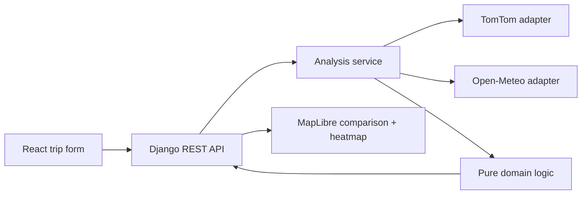

# RouteSafe

RouteSafe is a weather-aware truck-routing assessment built with React, TypeScript, Django REST Framework, TomTom Routing, Open-Meteo, and MapLibre. A trip request produces three genuine truck-route alternatives, ETA-based weather at distance checkpoints, distance-weighted risk summaries, a deterministic recommendation, and a 0–48 hour corridor heatmap.

> Hosted application: deployment-ready; not published from this local workspace  
> Walkthrough: record after the hosted frontend and API URLs are available

## What works

- Origin/destination geocoding and three distinct truck routes through TomTom.
- Checkpoints on decoded route geometry every 10, 25, or 50 miles.
- Time-zone-aware ETAs from TomTom's point-level travel-time profile and Open-Meteo hourly wind, rain, and snowfall lookup.
- Exact weather and load thresholds implemented only in the backend domain layer.
- Distance-weighted segment/risk miles, No Travel/incomplete-data safety gates, and lexicographic ranking.
- MapLibre route lines, detailed risk-colored checkpoint popups, a heatmap toggle, and a client-side 49-hour slider with Unknown cells.
- Structured validation/provider errors, retries for transient upstream failures, CORS, and throttling.
- De-duplicated weather coordinates and bounded concurrent forecast batches.
- Automated domain, service, serializer, and health-endpoint verification.

## Verified demonstration

The Denver, Colorado to Salt Lake City, Utah demonstration was live-smoke-tested on October 14, 2026 with a 35,000 lb load and 25-mile checkpoints. It returned three distinct truck routes, 23/22/21 checkpoints, complete ETA-matched weather, reconciled risk-mile totals, and a 105-point corridor with all 49 forecast hours. Provider-dependent route geometry, weather, and the recommendation will change over time.

## Local setup

Prerequisites: Node.js 22+, Python 3.12+, and a TomTom API key with Geocoding and Routing access.

### Provider credentials

Only `TOMTOM_API_KEY` is required for this assessment build.

1. Create or sign in to a TomTom developer account using the [TomTom API-key guide](https://docs.tomtom.com/platform/documentation/my-tomtom/how-to-get-a-tomtom-api-key).
2. Create a project and an API key with Geocoding and Routing access.
3. Paste the key after `TOMTOM_API_KEY=` in `backend/.env`. Do not put it in the root `.env`, React source, Git, screenshots, or chat.

The public non-commercial Open-Meteo endpoint used by this project does not require a key. Its free service terms and rate limits still apply. The default map uses attributed OpenStreetMap raster tiles from an inline MapLibre style so route layers do not depend on a remote style document; set `VITE_MAP_STYLE_URL` to a managed basemap style if your deployment requires an availability SLA.

```powershell
Copy-Item .env.example .env
Copy-Item backend\.env.example backend\.env
```

Set `TOMTOM_API_KEY` in `backend/.env`. Keep it server-side. The root `.env` controls the browser API base URL and optional MapLibre style URL.

Backend:

```powershell
cd backend
python -m venv venv
.\venv\Scripts\python.exe -m pip install -e ".[dev]"
.\venv\Scripts\python.exe manage.py runserver
```

Frontend, in another terminal:

```powershell
npm ci
npm run dev
```

Open `http://localhost:5173`. The API health check is `http://localhost:8000/api/v1/health/`.

## Architecture



The Django controller validates HTTP input and maps errors. `services/analysis.py` owns orchestration through typed provider ports. `domain/` contains framework-free geometry, ETA, weather selection, risk aggregation, corridor, and ranking functions. Provider keys never enter browser requests.

Request flow:

1. Validate the addresses, aware departure timestamp, IANA zone, load, and checkpoint interval.
2. Geocode both places and request one optimal plus two alternative truck routes.
3. Normalize TomTom route polylines and cumulative point-level travel times, and reject fewer than three distinct routes.
4. Generate on-route checkpoints and interpolate ETA from the route travel-time profile.
5. De-duplicate checkpoint and corridor coordinates and fetch bounded Open-Meteo batches concurrently.
6. Select each checkpoint's accumulation bucket, interpolate wind, classify risk, and aggregate segment miles.
7. Apply the safety gate and ranking tuple, then return route GeoJSON and all 49 heatmap hours once.

The frozen request/response fields are documented in [the API contract](docs/api-contract.md). The original implementation requirements are retained in [the implementation plan](docs/implementation-plan.md).

## Risk policy

| Level | Wind mph | Rain in/hour | Snow in/hour |
| --- | ---: | ---: | ---: |
| Low | `0 ≤ x < 25` | `0 ≤ x < 0.10` | `0 ≤ x < 0.5` |
| Moderate | `25 ≤ x < 35` | `0.10 ≤ x < 0.25` | `0.5 ≤ x < 1.0` |
| High | `35 ≤ x < 45` | `0.25 ≤ x < 0.50` | `1.0 ≤ x < 2.0` |
| Severe | `45 ≤ x < 55` | `0.50 ≤ x ≤ 1.00` | `2.0 ≤ x ≤ 3.0` |
| No Travel | `x ≥ 55` | `x > 1.00` | `x > 3.0` |

Wind `45–54.999 mph` becomes No Travel only above 30,000 lb. Wind `35–44.999 mph` becomes Severe only above 40,000 lb. Overrides never lower risk. Negative, non-finite, or missing required weather is Unknown.

Each segment takes the worse risk of its two endpoint checkpoints. Segment lengths are summed by risk; the numeric average is distance-weighted. A No Travel route cannot beat a route without No Travel miles, and an incomplete route cannot beat a complete eligible route. Remaining routes are sorted by `(severe miles, high miles, average risk, travel time, stable route ID)`.

Open-Meteo is requested in mph and inches with UTC Unix timestamps. `wind_speed_10m` is interpolated between adjacent samples; `rain` and `snowfall` use the hourly accumulation bucket containing the ETA. Total precipitation is not substituted for rain.

## Verification

```powershell
npm run build
cd backend
.\venv\Scripts\python.exe -m pytest
.\venv\Scripts\python.exe manage.py check
```

The test suite covers every threshold boundary, strict load boundaries, Unknown data, distance-weighted aggregation, route ranking gates, curved-geometry checkpoints, monotonic ETAs, forecast sampling, the orchestration response, serializer failures, and the health endpoint.

## Deployment

- `vercel.json` provides SPA rewrites for the React routes. In Vercel, set `VITE_API_BASE_URL` to the Render API origin and optionally set `VITE_MAP_STYLE_URL`.
- `render.yaml` defines the Django web service. Set `TOMTOM_API_KEY`, `DJANGO_ALLOWED_HOSTS`, and the exact `FRONTEND_ORIGINS` in Render.
- After publishing, verify health, submit the Denver → Salt Lake City demo, confirm three routes, and test from an incognito window before adding the two public URLs above.

## Submission steps that require the project owner

- Create the public GitHub repository and push this workspace. This local folder is not currently initialized as a Git repository.
- Deploy the API with `render.yaml`, configure the production environment variables, and deploy the frontend with `vercel.json`.
- Replace the hosted-application placeholder near the top of this README with the production URL.
- Record the required 5–10 minute Loom walkthrough and replace the walkthrough placeholder.
- Run the final hosted flow in an incognito browser and confirm the configured CORS origin.

## Limitations and safety

- TomTom may legitimately return fewer than three distinct routes; RouteSafe reports this as an analysis-unavailable error and never duplicates geometry.
- Forecast availability, rate limits, and provider terms apply. The app does not model closures, rest/fuel stops, driver-hours regulations, or vehicle dimensions.
- The supplied load is used only by the assessment's wind rules and is not sent as gross vehicle weight.
- The corridor uses bounded geodesic offsets and a 120-point budget; it is a forecast context layer, not a road-level hazard guarantee.

**Planning aid based on forecast data and assignment thresholds. Not a guarantee of road or vehicle safety. Follow official warnings, closures, and carrier policies.**

Routing and geocoding © TomTom. Weather data by Open-Meteo. The selected basemap provider's attribution is displayed by MapLibre.

# Author
## Ankit Kumar
